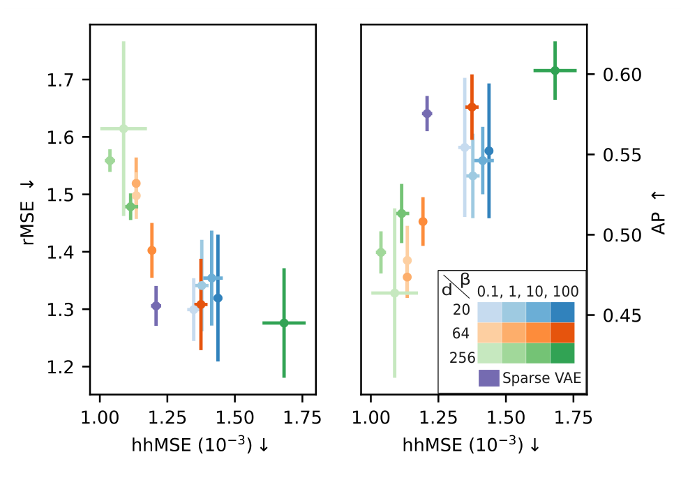
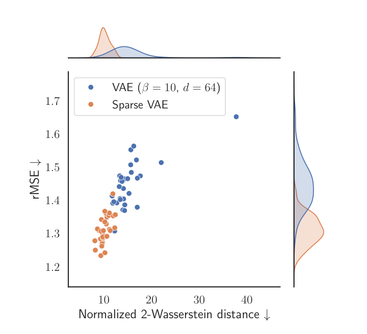
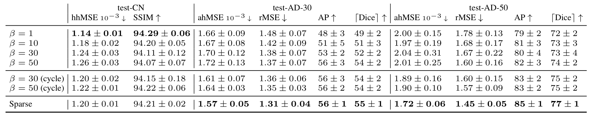

# VAEに基づく教師なし異常検知における再構成と検出のトレードオフの緩和

*Mitigating the Reconstruction-Detection Trade-off in VAE-based Unsupervised Anomaly Detection*

**ユーザー提供PDFの日本語全文訳（非公式）**

原文：Agathe Senellart, Maëlys Solal, Stéphanie Allassonnière, Ninon Burgos。原論文：[arXiv:2605.02918](https://arxiv.org/abs/2605.02918)。

> **翻訳の範囲と読み方（原論文の本文ではありません）**
>
> 提供された全6ページのPDFを対象に、要約せず、本文・要旨・図表の説明・謝辞を翻訳しました。節番号、段落の順序、数式・式番号、引用番号、数値を維持しています。著者名・所属・参考文献の書誌情報は原表記を残しています。図中の文字は原図のまま残し、日本語の対応を図の下に付けています。表1は横幅を抑えるため、同じ表をデータセット別に分けて掲載しています。
>
> 「原PDF p.○」はPDFの先頭を1とするページ番号です。原文でページをまたぐ段落は、読みやすさのため続けて訳し、両ページを表示しています。以下の本文では原文の記述を独自に修正していません。原文の数式・用語について注意が必要な点は、末尾の「翻訳上の確認事項」に本文と区別して記しています。公式実装由来の式や、本研究のボトル画像への提案は追加していません。

---

> 原PDF p.1：表題・著者・要旨

Agathe Senellart¹,⋆　Maëlys Solal²,⋆　Stéphanie Allassonnière¹,†　Ninon Burgos²,†

¹ Université Paris Cité, Inria, Inserm, HeKA, F-75015 Paris, France

² Sorbonne Université, Institut du Cerveau - Paris Brain Institute - ICM, CNRS, Inria, Inserm, AP-HP, Hôpital de la Pitié Salpêtrière, F-75013, Paris, France

⋆／† は、それぞれ共同筆頭著者／共同最終著者を示す。

PDF欄外の表記：arXiv:2605.02918v1 [cs.LG]、2026年4月9日。

## 要旨

変分オートエンコーダは、教師なし異常検知に広く用いられている。しかし、モデル選択は依然として未解決の問題である。完全に教師なしであることを保つため、ハイパーパラメータは、正常サンプルに対する再構成誤差を最小化するように選ばれることが多い。本論文では、β-VAEモデルにおいて、再構成品質と異常検知の間にトレードオフがあることを明らかにする。潜在空間に制約を加えたモデルは、検出指標が高くなる一方で、再構成品質が低くなる。また、乱数シードによる性能のばらつきを評価し、それが正常・異常の潜在分布間の距離と関連することを示す。この分析に基づき、再構成と検出のトレードオフを緩和する2つの方法、すなわちβスケジューリングとSparse VAEの妥当性を説明し、検討する。特に後者は、高い再構成品質を維持しながら検出を改善することを示している。

**キーワード：** 教師なし異常検知、深層生成モデル、擬似正常再構成。

## 1. はじめに

> 原PDF p.1

深層生成モデルに基づく教師なし異常検知（UAD）は、正常データだけでモデルを学習することにより、医用画像中の病変のような、まれな事象を検出するために用いられる。ラベル付きデータの入手が限られていることが、UADの利用を動機付けている。また、画像アーチファクトからさまざまな疾患に関連する病変まで、多様な種類の異常を検出できる可能性も、その動機となっている [1]。

生成モデルの中でも、変分オートエンコーダ（VAE）は、サンプル単位、あるいは異常度マップを通じたボクセル単位のUADに広く用いられている [2, 3]。いずれの場合も、正常分布を学ぶため、正常データを使ってモデルを学習する。推論時には、異常である可能性のあるテストサンプルに対して、再構成誤差 [4]、潜在空間内の距離 [3]、あるいはその両方 [5] から異常スコアを構成できる。ボクセル単位のUADでは、異常度マップを得るために各ボクセルの異常スコアを求める必要があるため、より難しい課題となる。そのための方法として、画像全体の代わりにパッチでオートエンコーダを学習し、各ボクセルのスコアを求めることができる [3]。別の方法は、異常画像の擬似正常版を生成し、その差分から異常度マップを求めることである [1]。Baurら [2] は、正常サンプルでVAEを学習すれば、異常サンプルを入力したときに、病変を正常組織に置き換えることで擬似正常画像を再構成する、という仮説を立てている。

UADにおいて手法とそのハイパーパラメータを選ぶための適切な基準を定めることは、依然として未解決の問題である。VAEによる再構成ベースの手法では、正常入力の再構成誤差に基づいてモデルを選ぶことが多い。しかし最近の研究では、学習の初期に選んだモデルの方が、十分に学習したモデルよりも再構成品質は低いにもかかわらず、異常をよりよく検出することが示されている [6]。ただし、この再構成品質の低下は、擬似正常再構成画像が患者データとかなり異なって見える可能性があるため、異常度マップの解釈可能性を損なう。この観察されたトレードオフは、モデルの学習に使う補助タスクである正常画像の再構成と、推論時のタスクである異常検知が一致していないことを示している。

さらに、正常から正常への再構成誤差が最も小さいモデルは、非常によく汎化するため、テスト画像の異常を再構成してしまうことがある [4]。この問題を避けるため、信頼できる異常から正常への再構成の必要条件として、異常サンプルの潜在コードが正常サンプルの潜在コードと同じ領域に属することを挙げた研究がある [5]。この目的を達成するため、潜在次元を減らす [4]、あるいは交差エントロピー損失を利用して潜在空間をさらに正則化する [5] など、潜在空間に制約を加える方法が提案されている。これまで、これらの方法はサンプル単位の異常検知にしか適用されておらず、ボクセル単位の異常度マップを設計するためにはまだ使われていない。モデル選択をさらに複雑にする要因として、十分に検討されていない安定性という基準もある。最近の研究では、検出性能が乱数シードによって大きく変動し得ることが明らかになっている [7]。

> 次の段落は原PDF p.1からp.2にまたがる。

これらの観察を踏まえ、ボクセル単位のUAD手法に重要な基準として、(i) 解釈可能性のための高品質な再構成、(ii) 高い異常検知性能、(iii) シードの変化に対する頑健性、を定める。これらの基準を調べるため、最近のベンチマークにおいて、FDG PET画像で認知症に関連する病変を検出する際の良好な性能が示されたβ-VAEモデルに着目する [8]。本研究の貢献は3つある。(1) 潜在次元とβの値が異なるβ-VAEモデルを用い、潜在空間への制約の影響を調べ、画像品質と異常検知の間にトレードオフがあることを示す。(2) 潜在空間の分析を通じて、シードによる性能のばらつきを調べる。(3) このトレードオフを緩和する2つの方法、すなわち学習中に段階的な正則化を行うβスケジューリング [9] と、潜在次元に適応的なドロップアウトを課すSparse VAE [10] を検討する。

## 2. 材料

### 2.1. 変分オートエンコーダ

> 原PDF p.2

β-VAEの枠組み [11, 12] では、正常な観測の集合 $X$ に含まれる観測 $x$ を低次元変数 $z\in\mathbb{R}^{d}$ に写すエンコーダ $q_{\phi}(z\mid x)$ と、潜在コードを観測へ戻すデコーダ $p_{\theta}(x\mid z)$ を学習することを目指す。通常は、$q_{\phi}(z\mid x)=\mathcal{N}(\mu(x),\sigma(x))$、$p_{\theta}(x\mid z)=\mathcal{N}(D(z),I)$ とする。ここで、$\mu$、$\sigma$、$D$ は、次の損失関数によって最適化するニューラルネットワークである。

$$
\mathcal{L}
=
\sum_{x\in X}
\mathbb{E}_{z\sim q_{\phi}(z\mid x)}
\left[\log p_{\theta}(x\mid z)\right]
-\beta\operatorname{KL}\!\left(q_{\phi}(z\mid x)\Vert p(z)\right).
\tag{1}
$$

最後の項は、$q_{\phi}(z\mid x)$ と事前分布 $p(z)=\mathcal{N}(0,I)$ の間のKullback–Leiblerダイバージェンスを表す。潜在コードが0に近いコンパクトな空間に位置するよう促すため、パラメータβを大きくすることができる。以降では、画像 $x$ のVAEによる再構成を $\hat{x}=D(\mu(x))$ と表す。[8] で得られた最適なアーキテクチャを用いる。モデルは、MultiVaeライブラリ [13] を使用し、学習率 $10^{-4}$、バッチサイズ4で100エポック学習する。

### 2.2. データ

> 原PDF p.2

ADNI [14] の3次元FDG PETスキャンのデータセットを用いる。これらの画像は、位置合わせ、平均化、および同じ解像度への統一が行われている。Clinica [15] の `pet-linear` パイプラインを用いて画像を前処理する。このパイプラインでは、MNI空間へのアフィン位置合わせ、切り取り、および小脳と橋の領域におけるPET集積の平均値を用いた強度の正規化を行う。ADNIにおいて、3年間を通じて一貫して認知機能正常（CN）と分類されている、安定した正常の被験者を選択する。学習には正常被験者302人の545画像を用い、テスト用としてCN被験者によるtest-CNと、アルツハイマー病（AD）被験者によるtest-ADの2つの集合を用意する。各テスト集合は50人の被験者から得られた50画像を含む。交差検証を行うため、学習データを5分割する。各分割では、およそ450画像を学習、66画像を検証に用いる。分割は被験者単位で行い、性別と年齢によって層化する。

### 2.3. 評価の枠組み

> 原PDF p.2

**正常から正常への再構成。** まず、平均二乗誤差（MSE）や構造的類似度（SSIM）[16] などの一般的な指標を用いて、正常画像を再構成する能力を評価する。以降、正常入力 $x$ とその再構成 $\hat{x}$ の間のMSE、すなわち $\operatorname{MSE}(\hat{x},x)$ をhhMSEと表す。

**シミュレーションの枠組み。** 異常サンプルから擬似正常画像を再構成する能力も評価する。異常画像と正常画像の正解ペアは得られないため、シミュレーションの枠組みを用い、ADに特徴的な現実的な低代謝を模擬する [17]。正常画像 $x$ に対する模擬異常画像を $x'=x+\varepsilon$ と表す。ADの重症度を増加させたシミュレーションを行い、2つのテストデータセットtest-AD-30とtest-AD-50を用いる。

**異常から正常への再構成。** $x'$ の擬似正常再構成と、その正解となる正常版 $x$ の間のMSEを、$\mathrm{ahMSE}=\operatorname{MSE}(\widehat{x'},x)$ と表す。

**ボクセル単位の異常検知指標。** 残差 $r=x-\hat{x}$ を異常度マップとし、正常な検証集合を用いて $\tilde{r}=(r-\mu_{\mathrm{HC}})/\sigma_{\mathrm{HC}}$ と正規化する。ここで、$\mu_{\mathrm{HC}}$ と $\sigma_{\mathrm{HC}}$ は、正常な検証集合（HC）の全画像にわたる $r$ の平均と標準偏差である。閾値処理前の異常度マップを評価するため、その絶対値 $|\tilde{r}|$ を用い、シミュレーションのマスクを正解として、ボクセル単位の平均適合率（AP）と $\lceil\mathrm{Dice}\rceil$（閾値全体にわたって得られる最良のDice係数）を計算する。これらは閾値処理の影響を受けやすいため、再構成の正常らしさを測る指標として、$\mathrm{rMSE}=\mathrm{ahMSE}/\mathrm{hhMSE}$ も定義する。この比は1に近いことが望ましい。これは、異常画像からの擬似正常再構成（ahMSE）が、正常画像からの再構成（hhMSE）と同程度に良い場合に対応する。

**実データにおけるサンプル単位の評価。** 実データで手法を評価する際には、正解となるセグメンテーションマスクが得られないため、$|\tilde{r}|$ のボクセルの平均として定義する異常スコアを抽出する。閾値処理前のサンプル単位スコアを、サンプル単位のAUCを用いて評価する。

## 3. 再構成品質と異常検知のトレードオフ

> 次の段落は原PDF p.2からp.3にまたがる。

潜在次元 $d$ を減らす、または重みβを増やすことで、β-VAEの潜在空間に制約を加えたときの影響を調べる。$\beta\in[0.1,1.0,10,100]$、$d\in[20,64,256]$ として12モデルを学習する。図1では、すべてのモデルについて、正常画像の再構成品質（hhMSE）に対する異常検知性能を示す。異常検知性能は、MSE比（rMSE = ahMSE / hhMSE）と平均適合率によって測る。β-VAEモデルの間に、再構成と検出のトレードオフが見られる。制約が弱いほど、例えばβが小さく $\beta=0.1$、潜在次元が大きく $d=256$ の場合には、再構成品質は良くなるが、検出性能は低くなる。全体として、この分析は、正常画像の再構成誤差（hhMSE）だけをUADのモデル選択基準にすべきではないことを示している。以降の実験では、このトレードオフを踏まえた良い妥協点である、$d=64$、$\beta=10$ のβ-VAEをベースラインとする。

**図1。** βと潜在次元 $d$ を変化させたβ-VAEにおける、再構成品質（hhMSE）と異常検知性能（rMSEおよびAP）のトレードオフ。各モデルについて、5つのシードでの平均と標準偏差を示す。

図中の英語の対応：hhMSE＝正常から正常への再構成MSE、rMSE＝ahMSE/hhMSE、AP＝平均適合率。↓は小さいほどよく、↑は大きいほどよいことを示す。横軸の $10^{-3}$ の表記と凡例の数値は原図のままである。

## 4. シードに対する安定性

> 原PDF p.3

このベースラインモデル（$d=64$、$\beta=10$）について、30の乱数シードで性能のばらつきを調べ、正常画像と異常画像の潜在分布間の距離を分析することで、その説明を試みる。具体的には、test-AD-30と正常テストサンプル（test-CN）の潜在コードの分布を多変量ガウス分布としてモデル化し、2-Wasserstein距離で比較する。正常なばらつきを考慮するため、正常な学習分布と検証分布の間の距離で割る。

図2では、30シードすべてについて、正常・異常サンプル間の正規化2-Wasserstein距離に対する正常らしさの比（rMSE）を示す。右側のrMSE分布に注目すると、シードを変えたときにモデル性能が非常に不安定であることが分かる。図2の散布図から、正常・異常の潜在分布間の距離は、2つの正常な潜在分布間の距離の少なくとも10倍であることが分かる。また、モデル性能（rMSE）が潜在距離と相関していることも分かる。これは、(1) 正常サンプルと異常サンプルに対するエンコーダ出力の間に大きなずれがあること、(2) この潜在空間のずれが再構成品質に直接影響しているため、デコーダによって補償されていないこと、を示している。[5] がサンプル単位で観察したことと同様に、最も性能が良いモデルは、潜在空間で正常サンプルと異常サンプルを最も分離しないモデルである。全体として、この分析は、エンコーダ関数とデコーダ関数の滑らかさが不足しており、それが悪影響を与えていることを示している。正常画像 $x$ と、異常画像 $x'=x+\varepsilon$ を考える。エンコーダが十分に滑らかでなければ、$\mu(x')$ は $\mu(x)$ と大きく異なる。デコーダもこの違いを補償できるほど滑らかでなければ、$D(\mu(x'))$ も、最適な擬似正常再構成 $D(\mu(x))$ と大きく異なるものになる。

**図2。** test-AD-30における再構成の正常らしさ（rMSE）と、正規化2-Wasserstein距離の散布図。各点は30シードのうちの1つを表す。

図中の英語の対応：Normalized 2-Wasserstein distance＝正規化2-Wasserstein距離。青はVAE（$\beta=10,d=64$）、オレンジはSparse VAEである。

## 5. より頑健なVAEの構築

> 原PDF p.3

モデルの滑らかさを改善し、第3節で観察したトレードオフを緩和するため、2つの方法を検討する。

### 5.1. 学習中の周期的βスケジューリング

デコーダの滑らかさを改善する最も単純な方法は、KL正則化の重みβを増やすことである。実際、対角の事後分布 $q_{\phi}(z\mid x)=\mathcal{N}(\mu(x),\operatorname{diag}(\sigma(x)))$ に対し、式(1)のKLダイバージェンスは次のように書ける。

$$
\sum_{i=1}^{d}\frac{1}{2}
\left(\sigma_i(x)^2-\log\!\left(\sigma_i(x)^2\right)+\mu_i(x)^2\right).
\tag{2}
$$

この正則化項を小さくするには、すべての $i$ について $\mu_i(x)\to0$、$\sigma_i(x)^2\to1$ とすることが望ましい。βを増やすと、$\sigma_i(x)^2$ がより大きくなるよう促され、事後分布の崩壊（$\sigma(x)^2\to0$ となること）を防ぐ。$(\sigma_i(x)^2)_i$ がより大きくなると、学習中に $z\sim\mathcal{N}(\mu(x),\operatorname{diag}(\sigma(x)))$ の任意の $z$ から $x$ をよく再構成しなければならないため、デコーダ関数はより滑らかであることを求められる。

しかし、図1で見たように、βを増やすと再構成品質は悪くなる。この影響を打ち消すため、[9] で提案されたように、学習中のKL正則化の重みβを周期的なスケジュールで変化させる。各周期の開始時には、良い再構成を学ぶために $\beta=0$ とし、潜在空間に構造を与えるため、周期を通じて最大値に向けて増加させる。学習を3周期に分け、βの最大値として大きな値 $\beta\in\{30,50\}$ を用いる。

### 表1：再構成と検出の結果

> 原PDF p.4上部。原文でも5.1節の後、5.2節の前に配置されている。

**表1。** 正常データセット（test-CN）と模擬ADデータセット（test-AD-30およびtest-AD-50）における再構成と検出の結果。各指標について、5つの分割とシードにわたる平均と標準偏差を示す。最良の指標を太字で示す。**訂正：ISBI 2026の予稿集に掲載された標準偏差は、分割ではなく被験者にわたって計算されていた。**

以下は同じ表を読みやすく分割したものである。指標の倍率・数値・太字は原表に対応させている。「周期」は原表のcycleを指す。

**test-CN**

| モデル | hhMSE $10^{-3}$ ↓ | SSIM ↑ |
| --- | ---: | ---: |
| $\beta=1$ | **1.14 ± 0.01** | **94.29 ± 0.06** |
| $\beta=10$ | 1.18 ± 0.02 | 94.20 ± 0.05 |
| $\beta=30$ | 1.24 ± 0.03 | 94.11 ± 0.12 |
| $\beta=50$ | 1.26 ± 0.03 | 94.07 ± 0.07 |
| $\beta=30$（周期） | 1.20 ± 0.02 | 94.15 ± 0.18 |
| $\beta=50$（周期） | 1.22 ± 0.01 | 94.22 ± 0.06 |
| Sparse | 1.20 ± 0.01 | 94.21 ± 0.02 |

**test-AD-30**

| モデル | ahMSE $10^{-3}$ ↓ | rMSE ↓ | AP ↑ | $\lceil\mathrm{Dice}\rceil$ ↑ |
| --- | ---: | ---: | ---: | ---: |
| $\beta=1$ | 1.66 ± 0.09 | 1.48 ± 0.07 | 48 ± 3 | 49 ± 2 |
| $\beta=10$ | 1.67 ± 0.08 | 1.42 ± 0.09 | 51 ± 5 | 51 ± 3 |
| $\beta=30$ | 1.70 ± 0.12 | 1.38 ± 0.07 | 53 ± 2 | 52 ± 2 |
| $\beta=50$ | 1.72 ± 0.13 | 1.37 ± 0.07 | 56 ± 3 | 54 ± 2 |
| $\beta=30$（周期） | 1.61 ± 0.07 | 1.36 ± 0.06 | 56 ± 3 | 54 ± 2 |
| $\beta=50$（周期） | 1.64 ± 0.03 | 1.35 ± 0.03 | 56 ± 2 | 54 ± 2 |
| Sparse | **1.57 ± 0.05** | **1.31 ± 0.04** | **56 ± 1** | **55 ± 1** |

**test-AD-50**

| モデル | ahMSE $10^{-3}$ ↓ | rMSE ↓ | AP ↑ | $\lceil\mathrm{Dice}\rceil$ ↑ |
| --- | ---: | ---: | ---: | ---: |
| $\beta=1$ | 2.00 ± 0.15 | 1.78 ± 0.13 | 79 ± 2 | 72 ± 2 |
| $\beta=10$ | 1.97 ± 0.19 | 1.68 ± 0.17 | 81 ± 3 | 73 ± 3 |
| $\beta=30$ | 2.04 ± 0.31 | 1.67 ± 0.22 | 80 ± 4 | 73 ± 4 |
| $\beta=50$ | 2.01 ± 0.25 | 1.60 ± 0.16 | 82 ± 3 | 74 ± 2 |
| $\beta=30$（周期） | 1.89 ± 0.16 | 1.60 ± 0.15 | 83 ± 2 | 75 ± 2 |
| $\beta=50$（周期） | 1.90 ± 0.10 | 1.57 ± 0.09 | 83 ± 2 | 75 ± 2 |
| Sparse | **1.72 ± 0.06** | **1.45 ± 0.05** | **85 ± 1** | **77 ± 1** |

### 5.2. Sparse VAE

> 原PDF p.4

もう1つの方法は、学習中に潜在コードへガウシアン・ドロップアウトを適用するSparse VAEモデル [10] である。このモデルでは、事後分布は次のように書ける。

$$
q_{\phi}(z\mid x)
=\mathcal{N}\!\left(\mu(x),\operatorname{diag}\!\left(\alpha\mu(x)^2\right)\right),
\tag{3}
$$

ここで、$\alpha\in\mathbb{R}^{d}$ は、ドロップアウト率と関連付けられる学習パラメータである。KL項は、αが大きくなるよう促す形に書き換えられる。潜在次元 $z_i$ が再構成に本当に有用でない限り、学習中に $\alpha_i$ が大きくなり、デコーダはその次元への依存を弱めるよう求められる。また式(3)は、$|\mu(x)|$ が大きいとSparse VAEのエンコーダ分散も大きくなり、正常分布の台の周囲に、デコーダがなお正常画像を再構成できる余裕領域を作ることを示している。本研究では、すべての $i$ について $\log\alpha_i=-3$ と経験的に初期化する。これは、正常サンプルでベースラインのβ-VAEと同程度の再構成誤差を達成する、最も高い値である。

### 5.3. 結果

> 原PDF p.4

表1に、模擬データセットにおける全モデルの結果を示す。各モデルは $d=64$ で学習する。βスケジューリングによってβ-VAEモデルの性能が改善することが分かる。$\beta=30$ の場合、周期的スケジュールのモデルは、hhMSEが小さくなる（1.20対1.24）と同時に、AP（56対53）と $\lceil\mathrm{Dice}\rceil$（54対52）が高くなる。同様に、Sparse VAEは、ベースモデルと比べて異常から正常へのMSEが良く（1.57対1.67）、異常検知の結果も良い。test-AD-30では、APが51から56に改善する。より重度の異常（test-AD-50）では、Sparse VAEはすべての指標で他の全モデルを上回る。全体として、このモデルは、図1に示すようにβ-VAEのトレードオフに対する改善を示している。図2では、この性能向上をさらに分析し、それに伴って正常・異常の潜在分布間の距離が小さくなることを示す。図2の周辺分布からも、このモデルがシード間でより安定していることが分かる。さらに、30シードにおけるAPの標準偏差を計算すると、Sparse VAEでは2.0、ベースラインモデルでは3.3であった。なお、表1のhhMSEに基づいてモデルを選んでいたなら、検出性能が最も低い $\beta=1$ のモデルを選んでいたことになり、これは本分析の意義を裏付けている。

**実際のADデータでの結果。** 本研究の関心はボクセル単位の異常検知にあるが、妥当性を確認するため、正常（CN）50人と実際のAD患者50人のテスト集合でも、第2.3節で述べたサンプル単位の異常スコアを計算してモデルを比較する。全モデルのAUCは [80.6, 81] の範囲となり、他を有意に上回るモデルはなかった。

## 6. 結論と今後の課題

> 原PDF p.4

β-VAEモデルを広範に実証分析し、再構成品質と異常検知の間のトレードオフを明らかにした。次に、学習シードによる性能のばらつきを分析し、それが正常・異常の潜在分布間の距離と関連することを見いだした。これは、異常サンプルの潜在コードには正常サンプルに対して有害なずれが存在することを確認するものであり、本研究ではこのずれを減らすことを目指している。これらの結果に基づき、この限界を克服する2つの方法、βスケジューリングとSparse VAEを検討した。どちらの方法も、良い品質の再構成を維持しつつ異常検知を改善することでトレードオフを緩和できるが、Sparse VAEはわずかに高い性能を達成するように見え、シードの違いに対してもより頑健であることが示された。著者らの知る限り、医用画像のボクセル単位における再構成と検出のトレードオフを緩和するために、潜在空間の適応的正則化を検討したのは本研究が初めてである。最後に、本論文の結果を得るために用いたコードはGitHubで公開している：[AgatheSenellart/tradeoff_vae_uad](https://github.com/AgatheSenellart/tradeoff_vae_uad)。

今後は、収縮型オートエンコーダ（contractive autoencoder; CAE）[18] やスパースオートエンコーダ（SAE）[19] など、ほかの方法も検討できる。これらは、重みやエンコーダのヤコビアンに対するL1またはL2正則化など、異なる制約を課すものである。これらの方法は、ボクセル単位の異常検知ではまだ検証されていない。さらに、学習データの純度が十分でないことなど、ほかのばらつきの原因に取り組むことも興味深い。本研究の手法と、学習データ中の外れ値に対する頑健性を高めるため損失を変更する [20] の方法を組み合わせることが考えられる。

## 7. 謝辞

> 原PDF p.5

本プロジェクトは、フランス政府のAgence Nationale de la Rechercheによる「France 2030」プログラム（ANR-23-IACL-0008、PRAIRIE-PSAI）、ANO-NEUROプロジェクト（ANR-23-CE45-0005-01）、「Investissements d’avenir」プログラム（ANR-19-P3IA-0001）、欧州連合のHorizon Europe Framework Programme（助成番号101136607、CLARAプロジェクト）、およびERC Synergy助成101071601（OCEAN）から、一部の資金提供を受けた。本研究では、GENCI-IDRISのHPCリソース（助成番号AD011011648、AD011016015）を使用した。ADNIのデータ収集と共有は、National Institute on Aging（National Institutes of Healthの助成番号U19AG024904）から資金提供を受けている。

## 8. 参考文献

> 原PDF p.5〜6。検索・照合のため、書誌情報は原表記を維持する。PDFの行末で分割された単語はつなげている。[8] はp.5の左右段にまたがり、[20] はp.6に掲載されている。

[1] X. Chen and E. Konukoglu, “Unsupervised abnormality detection in medical images with deep generative methods,” in *Biomedical Image Synthesis and Simulation*, pp. 303–324. Elsevier, 2022.

[2] C. Baur, S. Denner, B. Wiestler, N. Navab, and S. Albarqouni, “Autoencoders for unsupervised anomaly segmentation in brain MR images: A comparative study,” *MedIA*, vol. 69, pp. 101952, 2021-04.

[3] Z. Alaverdyan, J. Jung, R. Bouet, and C. Lartizien, “Regularized siamese neural network for unsupervised outlier detection on brain multiparametric magnetic resonance imaging: Application to epilepsy lesion screening,” *MedIA*, vol. 60, pp. 101618, 2020.

[4] Y. Cai, H. Chen, and K.-T. Cheng, “Rethinking autoencoders for medical anomaly detection from a theoretical perspective,” in *MICCAI*, 2024, vol. LNCS 15011, pp. 544–554.

[5] Y. Zhou, “Rethinking Reconstruction Autoencoder-Based Out-of-Distribution Detection,” in *CVPR*. 2022, pp. 7369–7377, IEEE.

[6] E. M. C. Huijben, S. Amirrajab, and J. P. W. Pluim, “Enhancing reconstruction-based out-of-distribution detection in brain MRI with model and metric ensembles,” *Comp. Meth. and Prog. in Biomed.*, vol. 272, pp. 109045, 2025.

[7] M. Solal, P. André, and N. Burgos, “Unsupervised anomaly detection in brain FDG PET with deep generative models: An experimental analysis of model variability and mitigation strategies,” in *SPIE Medical Imaging*, 2026.

[8] R. Hassanaly, M. Solal, O. Colliot, N. Burgos, and ADNI, “Benchmarking 3D generative autoencoders for pseudo-healthy reconstruction of brain 18F-FDG PET,” *JMI*, vol. 12, no. 05, 2025.

[9] H. Fu, C. Li, X. Liu, J. Gao, A. Celikyilmaz, and L. Carin, “Cyclical annealing schedule: A simple approach to mitigating KL vanishing,” in *NAACL*, 2019, pp. 240–250.

[10] L. Antelmi, N. Ayache, P. Robert, and M. Lorenzi, “Sparse multi-channel variational autoencoder for the joint analysis of heterogeneous data,” in *ICML*. 2019, vol. 97, pp. 302–311, PMLR.

[11] D. P. Kingma and M. Welling, “Auto-Encoding Variational Bayes,” 2013.

[12] I. Higgins, L. Matthey, A. Pal, C. Burgess, X. Glorot, M. Botvinick, S. Mohamed, and A. Lerchner, “Beta-VAE: Learning basic visual concepts with a constrained variational framework,” in *ICLR*, 2017.

[13] A. Senellart, C. Chadebec, and S. Allassonnière, “MultiVae: A Python package for multimodal variational autoencoders on partial datasets,” *JOSS*, vol. 10, no. 110, pp. 7996, 2025.

[14] S. G. Mueller, M. W. Weiner, L. J. Thal, R. C. Petersen, C. R. Jack, W. Jagust, J. Q. Trojanowski, A. W. Toga, and L. Beckett, “Ways toward an early diagnosis in Alzheimer’s disease: The Alzheimer’s Disease Neuroimaging Initiative (ADNI),” *Alzheimer’s & Dementia*, vol. 1, no. 1, pp. 55–66, 2005.

[15] A. Routier, N. Burgos, (...), M.-O. Habert, S. Durrleman, and O. Colliot, “Clinica: An open-source software platform for reproducible clinical neuroscience studies,” *Front. Neuroinform.*, vol. 15, pp. 689675, 2021.

[16] Zhou Wang, A. Bovik, H. Sheikh, and E. Simoncelli, “Image quality assessment: From error visibility to structural similarity,” *IEEE Trans. on Image Process.*, vol. 13, no. 4, pp. 600–612, 2004.

[17] R. Hassanaly, C. Brianceau, M. Solal, O. Colliot, and N. Burgos, “Evaluation of pseudo-healthy image reconstruction for anomaly detection with deep generative models: Application to brain FDG PET,” *MELBA*, vol. 2, pp. 611–656, 2024.

[18] S. Rifai, P. Vincent, X. Muller, X. Glorot, and Y. Bengio, “Contractive auto-encoders: explicit invariance during feature extraction,” in *ICML*. 2011, pp. 833–840, Omnipress.

[19] L. Meng, S. Ding, and Y. Xue, “Research on denoising sparse autoencoder,” *Int. J. Mach. Learn. & Cyber.*, vol. 8, no. 5, pp. 1719–1729, 2017.

> 原PDF p.6

[20] H. Akrami, A. A. Joshi, J. Li, S. Aydöre, and R. M. Leahy, “A robust variational autoencoder using beta divergence,” *Knowledge-Based Systems*, vol. 238, pp. 107886, 2022.

---

## 翻訳上の確認事項（原論文の本文ではありません）

以下は原文を読む際の注意であり、上の訳文の数式や主張を置き換えるものではありません。

1. **式(1)の符号：** 原文はこの式を「loss function」と呼んでいますが、表示されているのは「対数尤度の期待値 − β×KL」の形です。最小化用の「再構成誤差 ＋ β×正則化」へは勝手に符号を変換していません。
2. **式(2)の定数項：** 原文の式(2)には、標準的な対角ガウス分布と標準正規分布のKLに含まれる次元ごとの定数「−1」がありません。訳文でも原式のまま残しています。
3. **分散の記法：** 原文の2.1節と5.1節には $\mathcal{N}(\mu(x),\sigma(x))$ や $\operatorname{diag}(\sigma(x))$ という表記があり、式(2)とその説明では $\sigma_i(x)^2$ を用いています。この記法も独自に統一していません。
4. **5.1節の用語：** 原文は「posterior collapse」を括弧内の $\sigma(x)^2\to0$ と結び付けています。訳文はこの記述をそのまま残しています。一般的なVAEの事後崩壊の説明と同一視せず、原文の表現として確認してください。
5. **数値と範囲：** 表のSSIM・AP・Diceおよび実ADデータのAUC [80.6, 81] は、原文の数値表記を維持しています。独自に0〜1の尺度へ換算したり、本文にない単位を補ったりしていません。Sparse VAEの専用正則化の具体式は、この原論文の本文には展開されていないため、訳文にも追加していません。

**翻訳元の識別情報：** `sparce VAEに関する論文.pdf`、全6ページ、SHA-256 `0a4bb376961e5dedd864729e38065df929c3ed1823ac41b5da98adcd19092d4c`。翻訳作成日：2026-11-06。
